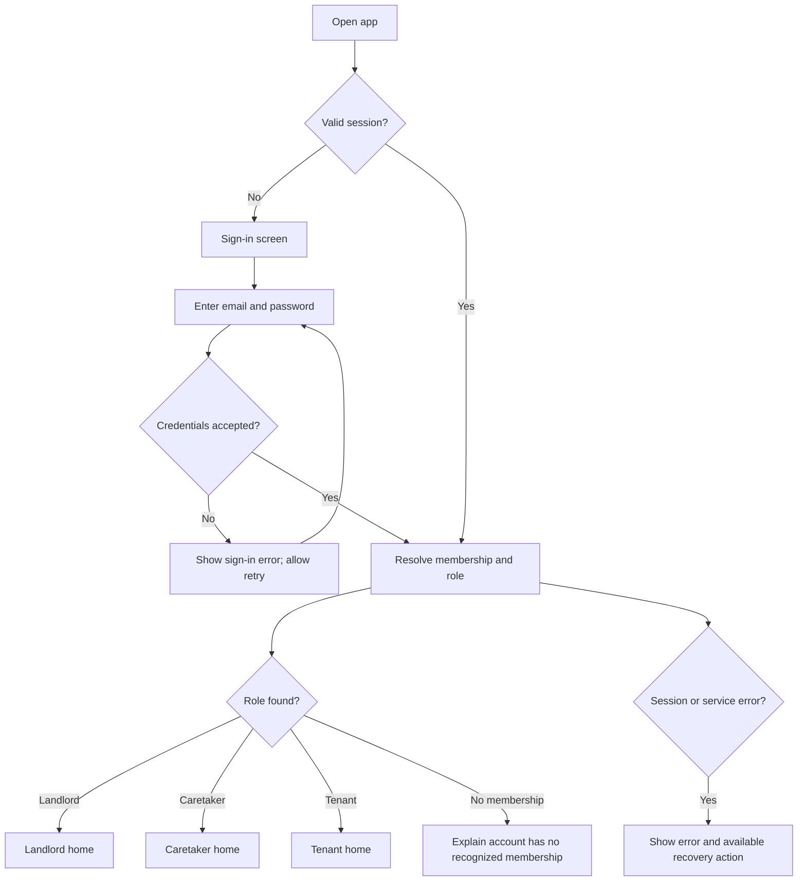
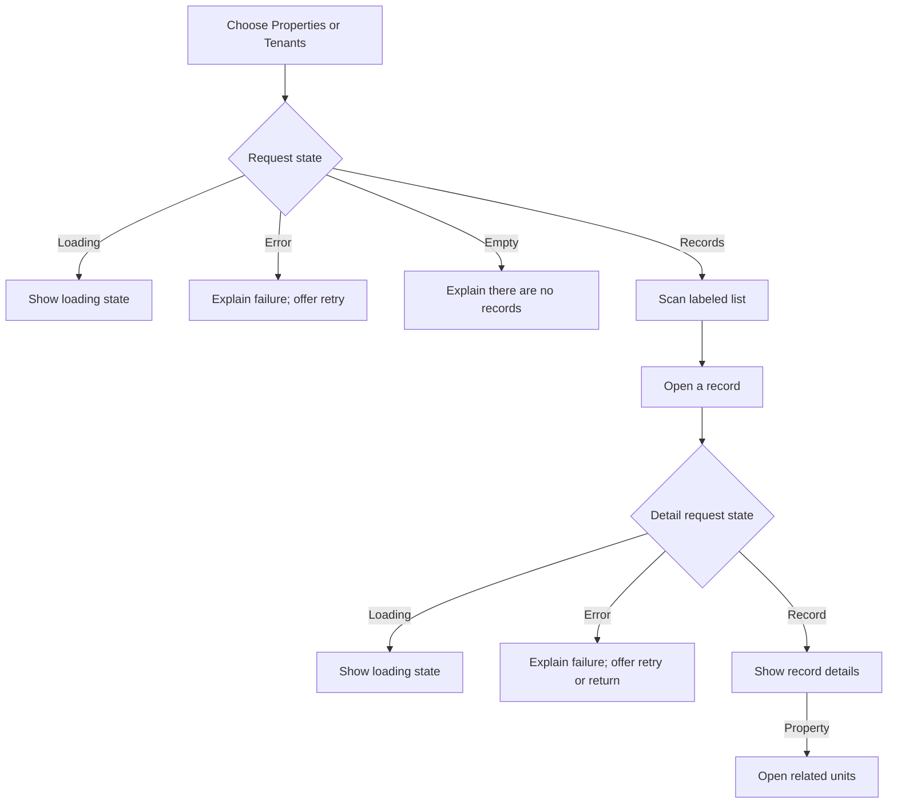
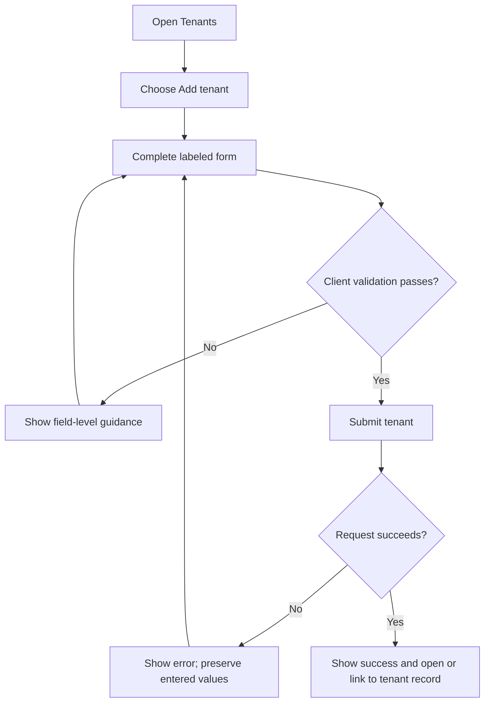
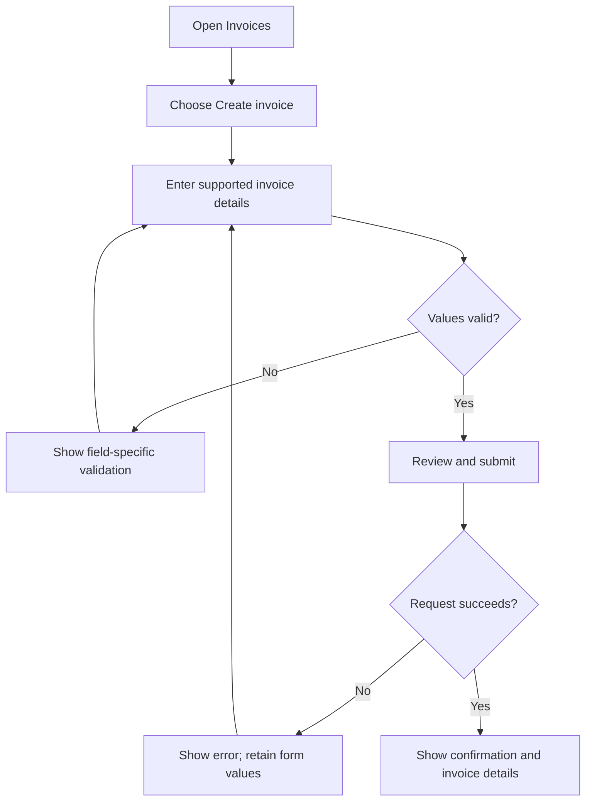
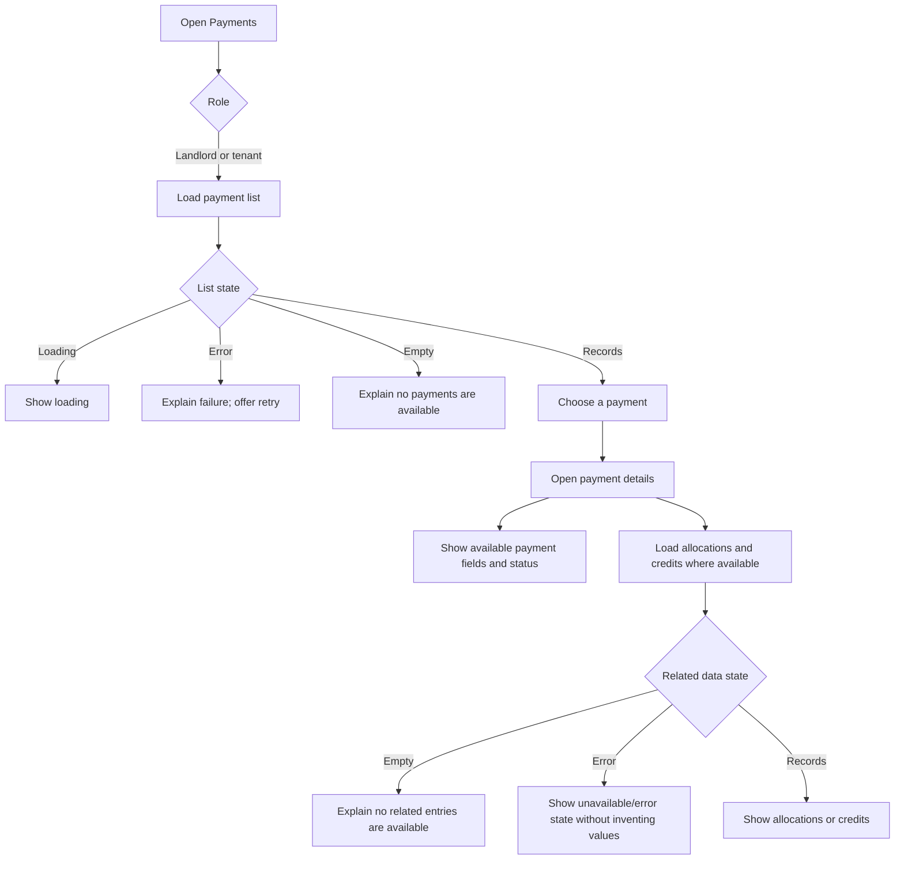
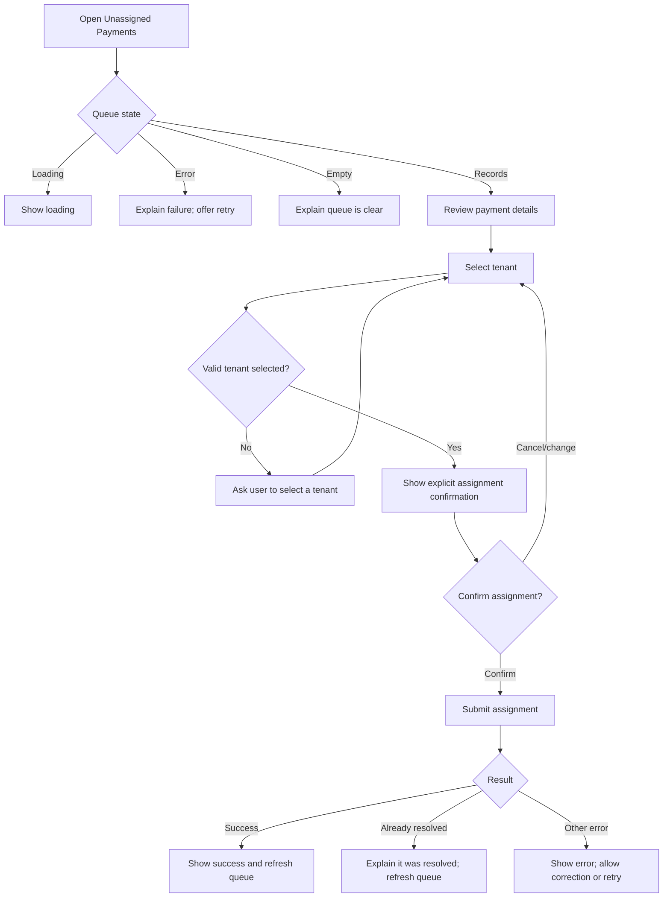
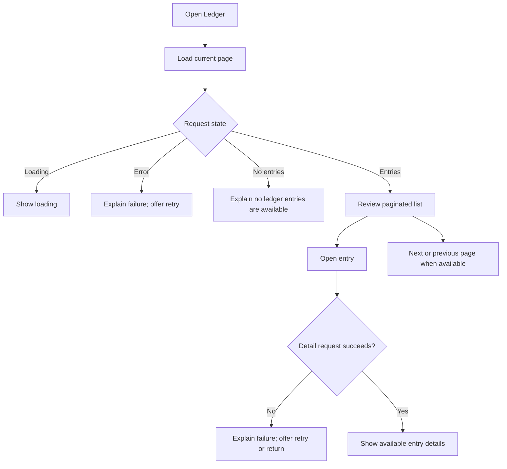

# KodiLedger User Flows

This document maps the user journeys supported by the current KodiLedger frontend. It is a UX and navigation reference; backend authorization remains authoritative. Role visibility and API field assumptions are documented in `README.md` and `src/lib/auth/roles.ts`.

## 1. Sign in and enter the role workspace

**Design notes:** Keep sign-in and membership resolution states distinct. Do not expose the app shell until role resolution succeeds. Provide retry or sign-out where useful; do not imply a user can self-provision a membership.

## 2. Role-aware navigation

| Destination | Landlord | Caretaker | Tenant |
| --- | :---: | :---: | :---: |
| Home | Yes | Yes | Yes |
| Properties | Yes | Yes | — |
| Tenants | Yes | Yes | — |
| Invoices | Yes | — | — |
| Payments | Yes | — | Yes |
| Unassigned payments | Yes | — | — |
| Ledger | Yes | — | — |

Units are reached through a property and can be opened by direct unit links. Unit creation and updates are landlord-only. Hiding navigation is a usability choice, not an authorization check; handle backend access errors clearly.

## 3. Browse properties, units, or tenants

**Design notes:** Use recognizable names and context before identifiers. On narrow screens, retain each table cell's label with its value. Keep list-to-detail navigation reversible with a clear path back.

## 4. Create a tenant (landlord or caretaker where permitted)

Only show fields supported by the implemented form and verified API contract. Do not imply that tenant account credentials or membership are created here.

## 5. Create an invoice (landlord)

Use clear currency and date labels. Do not present unsupported invoice editing, deletion, or tenant self-service actions.

## 6. Review a payment

The tenant view is limited to the `/payments` route and data returned for that user. Do not add tenant invoice self-service or payment initiation.

## 7. Assign an unassigned payment (landlord)

State which payment and tenant are involved before confirmation. Never describe the selection as an automatic match or display a match-confidence score. If the tenant list cannot be loaded, explain the fallback clearly and validate the entered tenant identifier before submission.

## 8. Review ledger activity (landlord)

Pagination behavior and available filters depend on the verified API contract. Do not invent filters or ledger mutation actions.

## 9. Shared states and recovery

| State | User experience |
| --- | --- |
| Loading | Show that content is loading without implying a result. Keep layout stable where practical. |
| Empty | Say what is empty and offer a supported next step if one exists. |
| Error | Explain that the request failed; provide retry or return navigation when possible. Preserve form values after recoverable failures. |
| Unavailable | Explain that information is unavailable. Do not show zero or placeholder financial figures as real data. |
| Access denied | Explain the user cannot access the destination; provide a safe return path. Role-aware navigation does not replace backend authorization. |
| Success | Confirm the completed action in plain language and link to the relevant record or refreshed list. |

All states must have visible text, keyboard-accessible actions, semantic structure, and sufficient contrast. Status color must always be paired with a text label.

## Unsupported journeys

Do not design as active workflows until product and backend support is confirmed: STK Push, tenant invoice self-service, caretaker financial actions, ledger mutations, registration or membership provisioning, property/tenant/invoice edit or delete, and offline financial data. See `README.md` for the full implementation boundary and known API assumptions.
